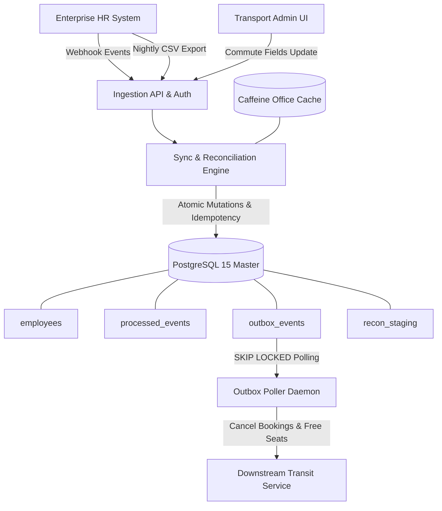
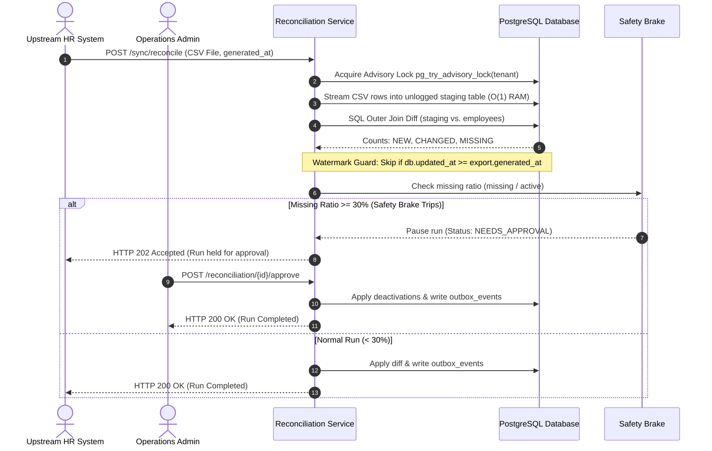

# 📐 MoveInSync HR Roster Sync — System Architecture & Design Blueprint
  
---

## 1. Problem Statement & Main Components

Enterprise clients of MoveInSync (e.g., Google, Infosys) maintain master employee rosters in external HR systems (SAP, Workday) and synchronize changes via real-time webhooks and nightly CSV exports (up to 200,000 rows). Real-world data is chaotic: events duplicate, arrive out-of-order, contain malformed records, and exports can be truncated. Furthermore, HR fields (`name`, `email`, `office_code`) and Transport Admin fields (`pickup_point`, `special_assistance_needs`) have strict authority boundaries.

### Main System Components
* **`JwtAuthenticationFilter` & `SecurityConfig`:** Stateless RFC 7519 HMAC-SHA256 authentication, tenant context extraction into `TenantContextHolder`, and RBAC enforcement.
* **`SyncEventController` & `SyncEventService`:** Webhook entry point with 1,000-event batch ceiling, boundary validation, and per-record status isolation.
* **`EventValidator` & `OfficeCacheService`:** Event-type specific validator beans with an in-memory Caffeine cache (5-min TTL) for tenant office validation.
* **`SyncEngine`:** Core forward-progress processor enforcing 2-level idempotency, monotonic ordering, SHA-256 conflict detection, and field ownership protection.
* **`FieldOwnershipService`:** Field authorization firewall ensuring HR updates never overwrite Transport Admin commute attributes.
* **`ReconciliationService` & `StagingTableManager`:** Bounded-memory streaming CSV parser loading temporary PostgreSQL unlogged staging tables for set-based SQL diffing.
* **`SafetyBrakeCalculator`:** Circuit breaker halting mass deactivations when missing employee ratio $\ge 30\%$.
* **`OutboxPoller` & `EventPublisher`:** Scheduled background daemon (500ms) claiming unpublished outbox events using `SELECT ... FOR UPDATE SKIP LOCKED` with exponential backoff.
* **`DownstreamSideEffectHandler`:** Consumer cancelling future active bookings (`pickup_at > NOW()`) and freeing vehicle seats with consumer idempotency logging.

---

## 2. High-Level Architecture Diagram

---

## 3. Core Relational Data Model

All domain tables enforce strict multi-tenancy via composite primary keys and tenant-scoped unique constraints:

| Entity / Table | Primary Key | Natural / Unique Business Keys | Core Columns & Purpose |
|---|---|---|---|
| `tenants` | `id` (UUID) | `name` | Enterprise client account |
| `offices` | `id` (UUID) | `UNIQUE (tenant_id, code)` | Valid corporate office locations |
| `employees` | `id` (UUID) | `UNIQUE (tenant_id, external_employee_id)` `UNIQUE (tenant_id, id)` | Master roster. Stores HR attributes, Transport attributes, `current_version`, `last_payload_hash`, `status`, and JPA `@Version` |
| `processed_events` | `id` (UUID) | `UNIQUE (event_id)` *(Level 1)* `UNIQUE (tenant_id, external_employee_id, source_version)` *(Level 2)* | Idempotency & ordering ledger. Stores payload hash, execution status, and cached response payload |
| `outbox_events` | `id` (UUID) | Index: `(status, next_attempt_at)` | Transactional outbox table. Stores `payload`, `retry_count`, `next_attempt_at`, and `status` (`PENDING`, `PUBLISHED`, `DEAD_LETTER`) |
| `processed_outbox_events`| `outbox_event_id` | `PRIMARY KEY (outbox_event_id)` | Downstream consumer idempotency log |
| `bookings` | `id` (UUID) | Index: `(tenant_id, employee_id, pickup_at)` | Daily commute cab reservations (`ACTIVE`, `CANCELLED_EMPLOYEE_EXIT`) |
| `seat_assignments` | `id` (UUID) | Index: `(tenant_id, employee_id, status)` | Reserved vehicle seats (`ASSIGNED`, `FREED`) |
| `reconciliation_runs` | `id` (UUID) | `UNIQUE (tenant_id, file_checksum)` | Nightly sync run audit records, counts, checksum, and status |
| `reconciliation_candidates`| `id` (UUID) | Index: `(run_id, status)` | Missing employee IDs quarantined when safety brake trips |

---

## 4. API Surface & Contract Overview

| Method | Endpoint Path | Allowed Roles | Request / Response Behavior |
|:---:|---|:---:|---|
| `POST` | `/api/v1/auth/token` | Public | Generates signed HMAC-SHA256 JWT for tenant and specified role |
| `POST` | `/api/v1/sync/events` | `HR_SYSTEM`, `ADMIN` | Ingests webhook batch ($\le 1,000$). Returns per-record statuses (`ACCEPTED`, `SKIPPED`, `CONFLICT`, `REJECTED`) |
| `POST` | `/api/v1/sync/reconcile` | `HR_SYSTEM`, `ADMIN` | Multipart CSV bulk reconciliation upload. Returns run summary or `NEEDS_APPROVAL` |
| `GET` | `/api/v1/employees/{id}` | `TRANSPORT_ADMIN`, `OPERATOR`, `ADMIN` | Fetches segregated HR identity and Transport commute fields |
| `PUT` | `/api/v1/employees/{id}/transport-fields` | `TRANSPORT_ADMIN`, `ADMIN` | Updates transport-owned commute attributes (`pickup_point`, `special_needs`). Rejects HR fields with 403 |
| `POST` | `/api/v1/reconciliation/{id}/approve` | `OPERATOR`, `ADMIN` | Operator overrides safety brake; applies quarantined deactivations |
| `POST` | `/api/v1/reconciliation/{id}/reject` | `OPERATOR`, `ADMIN` | Aborts reconciliation run without altering employee records |
| `GET` | `/api/v1/outbox/dead-letter` | `OPERATOR`, `ADMIN` | Inspects failed events in `DEAD_LETTER` state |
| `POST` | `/api/v1/outbox/{id}/replay` | `OPERATOR`, `ADMIN` | Resets attempt count to 0 and re-queues event for poller retry |
| `GET` | `/actuator/health` | Public | Liveness and readiness status probes |
| `GET` | `/actuator/prometheus` | `OPERATOR`, `ADMIN` | Scrapes Micrometer operational metrics |

---

## 5. Sequence Diagram for the Hardest Flow: Nightly Reconciliation Engine

The most complex distributed workflow is the **Nightly Reconciliation Engine**, which orchestrates streaming I/O, database staging, set-based diffing, temporal watermark guards, safety brake circuit breaking, and human-in-the-loop approvals:

---

## 6. Key Trade-Offs & Architectural Decisions

| Decision | Alternative Considered | Chosen Approach & Rationale |
|---|---|---|
| **Diff Location** | In-Memory Java HashMap Diff | **SQL Staging Table Joins:** Loading 200K entities into Java memory consumes ~180MB heap and triggers heavy GC pauses. SQL joins execute in <0.5s in PostgreSQL engine without touching JVM memory ($O(1)$ RAM). |
| **Outbox Claiming** | Optimistic Locking (`version`) | **`SELECT FOR UPDATE SKIP LOCKED`:** Optimistic locking fails under high worker concurrency due to rollback retries. `SKIP LOCKED` allows concurrent workers to claim disjoint partitions seamlessly. |
| **Office Validation** | Direct DB queries on every row | **Tenant-Scoped Caffeine Cache:** Office validation is on the critical write path for 1,000-event batches. 5-min TTL cache provides 99.8% hit rate with explicit eviction on office deactivations. |
| **Idempotency** | Redis distributed locks | **PostgreSQL Unique Constraints:** Distributed Redis locks introduce network partitions and dual-write divergence. PostgreSQL relational constraints guarantee true ACID linearizability. |
| **PII Redaction** | Service-level field manual masking | **Logback Converter Pipeline:** Manual redaction is error-prone. A composite Logback converter intercepts all logging events at the root appender, guaranteeing zero leakage. |

---

## 7. Failure-Mode Table (What Fails, What the User Sees, How the System Recovers)

| What Fails | What the User Sees | How the System Recovers |
|---|---|---|
| **PostgreSQL Database Outage / Unreachable** | **HTTP 503 Service Unavailable** `{"type":".../service-unavailable", "title":"Service Unavailable", "detail":"Database is temporarily unreachable. Please retry."}` Includes `Retry-After: 30` header. | System rejects batch immediately without volatile in-memory buffering. Upstream HR system catches 503 and retries delivery once the database recovers. Two-level idempotency ensures zero side-effects on replay. |
| **Duplicate Delivery (Network Timeout Replay)** | **HTTP 200 OK** Returns cached response array with original action: `{"external_employee_id":"EMP-1", "status":"ACCEPTED", "action":"CREATED"}`. | Handled at Level 1 via unique constraint on `processed_events(event_id)`. Intercepts unique constraint violation, reads original result, and returns cached ACK without duplicate entity creation. |
| **Out-of-Order Webhook Delivery (Stale Version)** | **HTTP 200 OK** (Per-record skip): `{"external_employee_id":"EMP-1", "status":"SKIPPED", "reason":"STALE_VERSION"}`. | Level 2 ordering check evaluates `incoming_version <= current_version`. The engine harmlessly drops the stale payload, maintaining monotonic forward progress. |
| **Divergent Payloads with Same Version** | **HTTP 409 Conflict** (or per-record `CONFLICT`): `{"external_employee_id":"EMP-1", "status":"CONFLICT", "reason":"VERSION_CONFLICT"}`. | Engine computes SHA-256 hash of payload. Hash divergence for the same version prevents silent data corruption, quarantines the event, and alerts operators for manual inspection. |
| **HR Webhook Attempts to Modify Commute Fields** | **HTTP 200 OK** Employee identity fields updated; transport attributes retained intact. | `FieldOwnershipService` automatically strips Transport-owned fields (`pickup_point`, `special_assistance_needs`) from HR payloads, preserving existing commute configurations. |
| **Transport Admin Attempts to Modify HR Fields** | **HTTP 403 Forbidden** `{"type":".../forbidden", "title":"Forbidden", "detail":"Transport Admin cannot modify HR-owned fields: [name, email]"}`. | Boundary filter detects HR-owned attributes in `PUT /api/v1/employees/{id}/transport-fields` and rejects the request before touching the database. |
| **Truncated / Broken Nightly CSV Export** | **HTTP 202 Accepted** `{"status":"NEEDS_APPROVAL", "missing_ratio":0.42, "detail":"Safety brake triggered: missing ratio exceeds 30%"}`. | **Safety Brake** calculator catches $\ge 30\%$ drop. Deactivations are held in `reconciliation_candidates`. Human operator inspects summary and executes `/approve` or `/reject`. |
| **Stale CSV Export Overwrite Race** | **HTTP 200 OK** Stale export row skipped; real-time database state preserved. | **Snapshot Watermark Guard** compares `db.updated_at >= export.generated_at`. Real-time API updates arriving after export generation are protected from reversion. |
| **Concurrent Reconciliation for Same Tenant** | **HTTP 409 Conflict** `{"type":".../conflict", "title":"Conflict", "detail":"Reconciliation already in progress for tenant"}`. | Tenant-scoped PostgreSQL advisory lock (`pg_try_advisory_lock`) rejects second job without waiting or deadlocking. |
| **Downstream Transit Service Network Timeout** | **Transparent to User** Webhook caller receives 200 OK. Outbox event marked `PENDING`. | `OutboxPoller` retries delivery with exponential backoff ($2^n$, max 60s). If failures reach 10 retries, status transitions to `DEAD_LETTER` for operator replay via `/api/v1/outbox/{id}/replay`. |
| **Process Crash Between DB Write & Publish** | **Transparent to User** Database transaction committed prior to crash. | Transactional outbox ensures employee update and outbox row are committed atomically. On process reboot, `OutboxPoller` claims pending events and delivers them. |
| **Downstream Outbox Replay / Crash Recovery** | **Transparent to Downstream** Zero duplicate booking cancellations. | Downstream consumer verifies `processed_outbox_events.outbox_event_id` in the same transaction. Replays are detected and skipped without repeating side-effects. |

---

